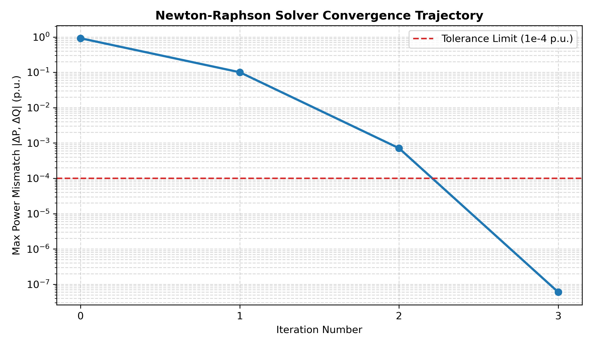
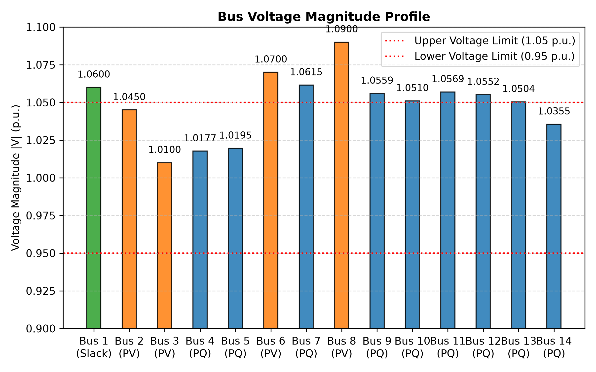
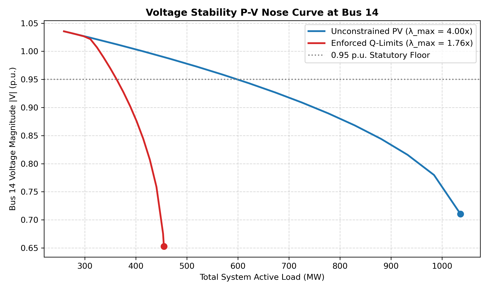
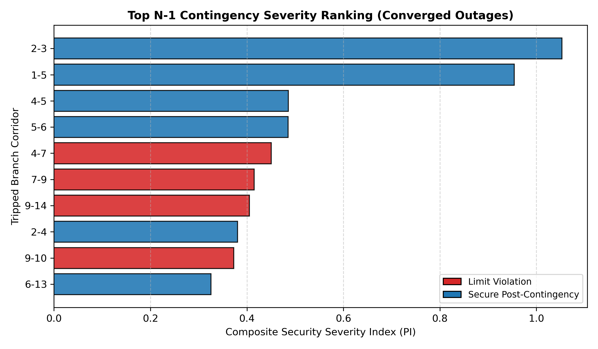
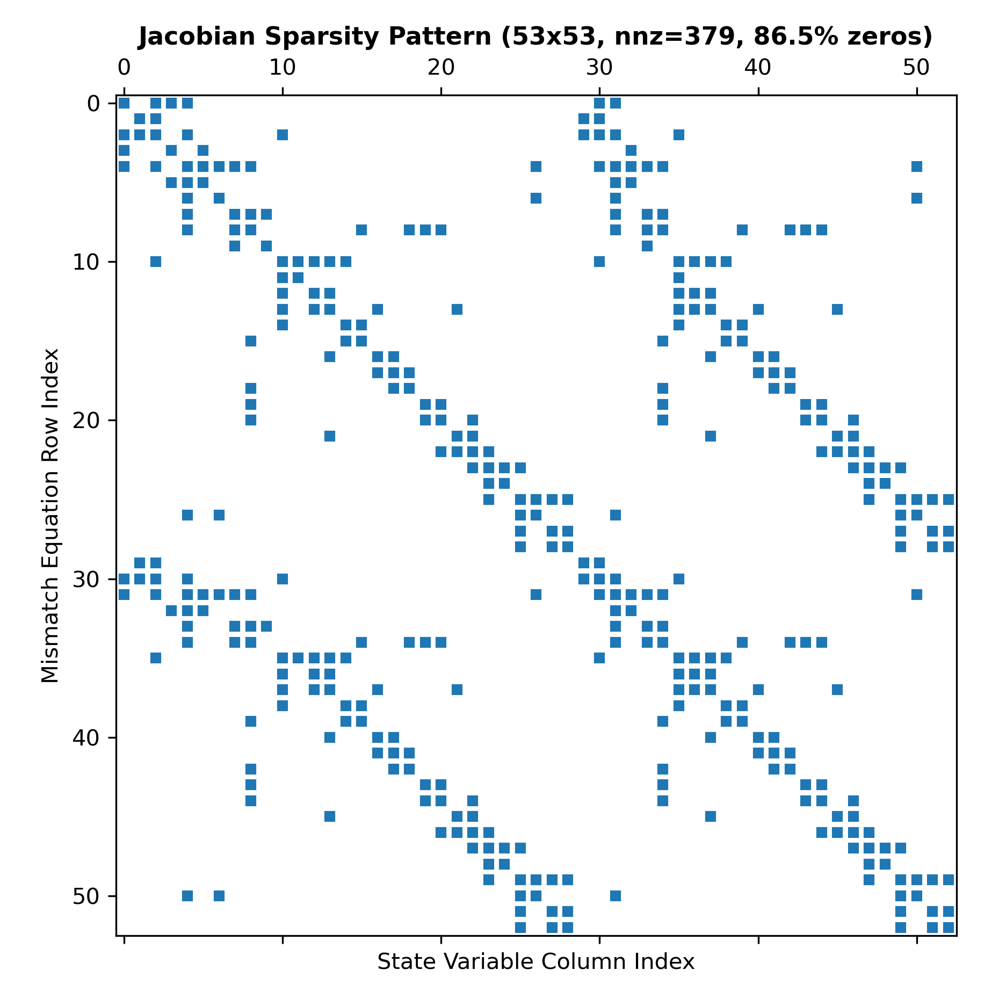

# Power Systems Sparse CSC Newton-Raphson Load Flow & Grid Security Suite

A Python numerical analysis package for **balanced AC power-flow calculation, PV generator reactive-capability enforcement, automated N-1 contingency security screening, and saddle-node bifurcation P--V voltage stability analysis**.
Validated to reference precision against MATPOWER `case14`, MATPOWER `case_ieee30`, pandapower, and closed-form analytical power-transfer equations.

I benchmark against pandapower rather than a remembered value, and the residual is probably more informative than the pass or fail line.

> **Live Interactive Web Explorer (Zero Install):**
> [https://hariszafar740-lang.github.io/power-systems-newton-raphson-solver/](https://hariszafar740-lang.github.io/power-systems-newton-raphson-solver/)

---

## What Makes This Solver Unique

1. Direct O(nnz) `scipy.sparse` CSC Engine (`src/ybus_builder.py`, `src/jacobian_builder.py`):
Assembles complex bus-admittance (Y_bus) and reduced Jacobian (J) matrices directly from branch COO triplets into Compressed Sparse Column (`csc_matrix`) storage without allocating N ×N dense arrays.
Achieving 86.5% Jacobian sparsity on IEEE 30-bus and >96% sparsity / ~15–28x speedup at 100–160 buses.
2. PV Generator Q_min / Q_max Reactive-Limit Switching (`src/q_limit_solver.py`):
Enforces generator reactive capability bounds (`most_severe` or simultaneous `PV -> PQ` conversion with `PQ -> PV` voltage backoff reversion).
Accounting for local reactive demand Q_d at generator buses and matching `pandapower` (`enforce_q_lims=True`) to < 10^(-6) p.u.
3. Coupled N-1 Contingency Security Screening (`src/contingency_analyzer.py`):
Combines BFS topological islanding detection with warm-started sparse AC contingency solves, branch MVA thermal overload checks, and composite Performance Index (PI) ranking.
Demonstrating how Corridor `1-2` outage on IEEE 14-bus triggers reactive exhaustion collapse when physical Q-limits are enforced.
4. Saddle-Node Bifurcation P--V Nose-Curve Analyzer (`src/voltage_stability.py`):
Adaptive binary step-halving continuation tracer tracking smallest Jacobian singular value (σ_min(J) →0) and PV Q-saturation kinks.
Proving IEEE 14-bus loadability contracts from 4.00× (1036 MW) unconstrained to 1.76× (455 MW) under MATPOWER Q-limits.
5. Installable PEP 621 Package & `nr-powerflow` CLI (`src/cli.py`):
Ships a clean command-line interface (`solve`, `contingency`, `pv-curve`, `benchmark`) outputting human-readable Markdown tables or structured JSON.

---

## Mathematical Formulation

The non-linear active and reactive power balance equations solved per bus i via complex phasor products S = V ⊙ (Y_busV)^*:

~~~
P_i = Σ_(j=1)^N | V_i | | V_j | (G_ijcosθ_ij + B_ijsinθ_ij), Q_i = Σ_(j=1)^N | V_i | | V_j | (G_ijsinθ_ij - B_ijcosθ_ij)
~~~

State corrections Δx = [Δθ, Δ| V |]^T are solved at each iteration via sparse LU factorization (`scipy.sparse.linalg.spsolve`) of the reduced Jacobian:

~~~
[ΔP;
ΔQ] = [J_11, J_12;
J_21, J_22] [Δθ;
Δ| V |]
~~~

---

## Simulation Artifacts

### 1. Quadratic Convergence & Bus Voltage Profile (IEEE 14-Bus)

### 2. Voltage Collapse P--V Nose Curve & N-1 Contingency Security Ranking (IEEE 14-Bus)

### 3. Reduced Sparse CSC Jacobian Structure (IEEE 30-Bus, 86.5% Zeros)

---

## Validation Benchmarks

* IEEE 14-Bus (`src/ieee14_data.py`): Pinned to MATPOWER `data/case14.m` (100 MVA base).
* Agrees with `pandapower` 3.x reference to < 5 ×10^(-7) p.u. on voltages (P_loss = 0.1339 p.u.
* Q_loss = 0.3012 p.u.), and reproduces `enforce_q_lims=True` stressed states (`1.15x` partial & `1.25x` cascade saturation) to < 10^(-6) p.u.
* IEEE 30-Bus (`src/ieee30_data.py`): Pinned to MATPOWER `data/case_ieee30.m` (30 buses, 41 branches, 4 off-nominal tap transformers, 2 shunt capacitor banks).
* Converges quadratically in 3 iterations (P_loss = 0.1756 p.u., Q_loss = 0.3298 p.u.) within < 5 ×10^(-6) p.u. of reference.
* Analytical Two-Bus Bifurcation (`tests/test_voltage_stability.py`): Reproduces closed-form lossless nose-point transfer P_max = V_1^2 / (2X) and V_crit = V_1 / √(2) within 0.05%.

---

## Quickstart & CLI Usage

~~~bash
python -m pip install -r requirements.txt
python -m pip install -e.

~~~
# Run full benchmark demonstration & regenerate diagnostic figures
python main.py

# Engineering CLI subcommands
nr-powerflow solve --case ieee14 --load-mult 1.25 --enforce-q-limits nr-powerflow solve --case ieee30 --format json nr-powerflow contingency --case ieee14 --enforce-q-limits --top 8 nr-powerflow pv-curve --bus 14 --plot results/pv_nose_curve.png nr-powerflow benchmark --sizes 14 30 80 160

# Build static interactive web dashboard locally
python -m src.web_dashboard --out-dir site

# Run full 72-test verification suite + Ruff linter
python -m pytest tests/ -v ruff check.
~~~

---

~~~
## Repository Structure

~~~text
├── main.py # Demonstration entry point (IEEE 14 & IEEE 30)
├── pyproject.toml # PEP 621 package, CLI script, Ruff & pytest config
├── CITATION.cff # Academic BibTeX / APA citation metadata
├── results/ # High-DPI benchmark diagnostic figures (5 PNGs)
├── src/
│ ├── __init__.py # Public package API (v1.0.1)
│ ├── bus_data.py # 3-bus test network specification
│ ├── ieee14_data.py # MATPOWER case14 data + Q-capability curves
│ ├── ieee30_data.py # MATPOWER case_ieee30 benchmark + shunts/Q-limits
│ ├── ybus_builder.py # Direct O(nnz) CSC sparse & dense Y_bus builder
│ ├── mismatch_calculator.py # Complex phasor power injection & mismatch engine
│ ├── jacobian_builder.py # Sparse CSC & dense reduced Jacobian builder
│ ├── nr_solver.py # Newton-Raphson solver (spsolve & dense modes)
│ ├── q_limit_solver.py # PV-to-PQ Q_min/Q_max switching & backoff engine
│ ├── line_flow_calculator.py # Complex branch power flows & network losses
│ ├── contingency_analyzer.py # Automated N-1 security & islanding screener
│ ├── voltage_stability.py # P-V nose curve & bifurcation margin analyzer
│ ├── sparse_benchmark.py # Synthetic meshed grid scaling benchmark
│ ├── visualizer.py # High-DPI Matplotlib diagnostics & spy plots
│ ├── cli.py # nr-powerflow command-line interface
│ └── web_dashboard.py # Static interactive HTML5 explorer builder
└── tests/ # 72 automated unit, physics & reference tests
~~~
